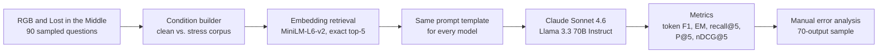

# Diagnosing RAG Failures

[](https://papers.ssrn.com/sol3/papers.cfm?abstract_id=7439478)
[](https://doi.org/10.2139/ssrn.7439478)
[](LICENSE)


Experiment code and data for **[Diagnosing RAG Failures: A Taxonomy of Failure Modes in Retrieval-Augmented Generation](https://papers.ssrn.com/sol3/papers.cfm?abstract_id=7439478)** (Dawit Zeleke Admassu, 2026).

The paper defines five ways retrieval-augmented generation (RAG) systems fail and tests three of them empirically. This repository contains the evaluation pipeline, frozen configuration, prompts, dataset provenance, and error-analysis materials behind that validation.

## The five failure modes

| Mode | What goes wrong | Tested here |
|---|---|:---:|
| **Retrieval Blindness** | Retrieval surfaces no useful evidence, so the answer is generated "in the dark" | ✅ |
| **Retrieval Noise** | Retrieved content is irrelevant or misleading and contaminates the context | ✅ |
| **Evidence Ignorance** | Retrieval succeeds, but the model ignores the context and falls back on parametric knowledge | ✅ |
| **Evidence Over-Reliance** | The model trusts retrieved content too readily, passing on incorrect or outdated information | — |
| **Latency-Induced Failure** | Retrieval cannot finish within time or resource limits, so the answer uses partial or stale context | — |

## How the experiment works



Each failure mode compares a **clean** condition with one or more **stress** conditions:

| Mode | Clean | Stress |
|---|---|---|
| Retrieval Blindness | Gold passage in the corpus | Gold passage removed (`blind`) |
| Retrieval Noise | Gold passage only | RGB distractors injected (`noisy`) |
| Evidence Ignorance | Gold passage at the top (`top`) | Gold in the middle of 10 documents (`middle`), or removed (`removed`) |

## Key results

Mean token F1 across 900 real API calls (450 per model), as reported in the paper:

| Mode | Condition | Claude Sonnet 4.6 | Llama 3.3 70B | Recall@5 |
|---|---|---:|---:|---:|
| Retrieval Blindness | clean | 0.108 | 0.260 | 0.767 |
| | blind | 0.028 | 0.029 | 0.000 |
| Retrieval Noise | clean | 0.117 | 0.446 | 1.000 |
| | noisy | 0.066 | 0.230 | 0.633 |
| Evidence Ignorance | top | 0.067 | 0.189 | 1.000 |
| | middle | 0.067 | 0.182 | 1.000 |
| | removed | 0.032 | 0.063 | 0.000 |

- **Both models degrade under every stress condition** tested.
- **Moving the gold passage to the middle barely mattered; removing it did.** For these models at 10 documents, this points to an evidence-availability effect rather than a "lost in the middle" position effect.
- **Low absolute F1 scores are expected:** both models answer in full sentences rather than short spans, and token F1 penalizes that. Compare conditions, not raw values.
- The full run cost about **$1.86** ($1.82 Claude, $0.04 Llama).

This is a small, preliminary study: two models, one benchmark family, 90 questions. See the paper's limitations section for details.

## Repository structure

```
.
├── paper/                       Manuscript PDF, LaTeX source, bibliography
└── rag_eval/
    ├── config/                  Frozen experiment settings and prompt templates
    ├── data/                    Dataset loaders and provenance manifest (90 item IDs)
    ├── retrieval/               Embedding wrapper and exact cosine-similarity index
    ├── conditions/              Clean/stress corpus builders and invariant checks
    ├── models/                  Claude, Llama, GPT-4.1, and mock adapters
    ├── runner/                  Resumable generation runner (with --dry-run)
    ├── eval/                    Metrics and results aggregation
    ├── error_analysis/          Rubric, audit protocol, AI-drafted and human-audited labels
    ├── logs/                    Dry-run evidence and no-context baseline
    ├── scripts/                 Manifest builder and helper scripts
    └── tests/                   Unit tests
```

## Quick start

No API keys and no cost:

```bash
cd rag_eval
python3 -m venv .venv && source .venv/bin/activate
pip install -r requirements.txt
python -m unittest discover tests        # 51 tests
python -m runner.run_generation --dry-run
python -m eval.run_eval --dry-run
```

The dry run uses the real sampled questions and real retrieval with a mock generator. To run tests that need the raw benchmark files, or to run the real experiment, download the datasets at the exact commits listed in [`rag_eval/data/dataset_manifest.json`](rag_eval/data/dataset_manifest.json). The raw files aren't redistributed here.

To reproduce the real runs, copy `rag_eval/.env.example` to `rag_eval/.env`, add your API keys, and follow [`rag_eval/README.md`](rag_eval/README.md). Real runs make paid API calls.

## Citation

```bibtex
@misc{admassu2026diagnosingrag,
  author       = {Admassu, Dawit Zeleke},
  title        = {Diagnosing RAG Failures: A Taxonomy of Failure Modes in Retrieval-Augmented Generation},
  year         = {2026},
  howpublished = {SSRN},
  note         = {Available at SSRN 7439478},
  doi          = {10.2139/ssrn.7439478}
}
```

## License

Code is released under the [MIT License](LICENSE). The [RGB](https://github.com/chen700564/RGB) and [Lost in the Middle](https://github.com/nelson-liu/lost-in-the-middle) benchmarks remain under their original licenses.
